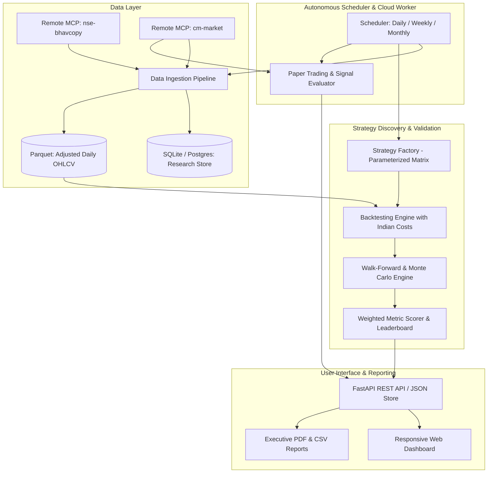

# IMPLEMENTATION & SYSTEM ARCHITECTURE PLAN
**Project:** Autonomous NSE Quantitative Research & Strategy Discovery Platform  
**Target:** Production-Grade Cloud Worker & Dashboard Engine  
**Author:** Antigravity Quant Team  

---

## 1. System Architecture Overview



---

## 2. Directory Layout
```
stcks_predictor/
├── docs/
│   ├── REPOSITORY_AUDIT.md
│   ├── MCP_DATA_SOURCE_AUDIT.md
│   └── IMPLEMENTATION_PLAN.md
├── src/
│   ├── config.py                  # Environment, costs, universes, and paths
│   ├── data/
│   │   ├── mcp_client.py          # Unified client for nse-bhavcopy & cm-market
│   │   ├── ingestion.py           # Historical data fetcher with checkpointing
│   │   ├── corporate_actions.py   # Split/bonus price adjustment engine
│   │   └── storage.py             # SQLite metadata & Parquet price series
│   ├── strategies/
│   │   ├── base.py                # Abstract strategy interface & signals
│   │   ├── momentum.py            # EMA, MACD, RSI, 52W High momentum
│   │   ├── breakout.py            # Donchian, 20D/50D/52WH, Volume breakouts
│   │   ├── mean_reversion.py      # RSI oversold, Bollinger Band bounce
│   │   ├── volume_action.py       # Relative volume, Volume-Price divergence
│   │   └── combinations.py        # Trend + Volatility + Relative Strength
│   ├── backtester/
│   │   ├── costs.py               # Indian transaction costs (STT, GST, SEBI, Slippage)
│   │   ├── engine.py              # Realistic vectorized backtester without lookahead
│   │   └── metrics.py             # CAGR, Sharpe, Sortino, Calmar, MaxDD, WinRate, Expectancy
│   ├── validation/
│   │   ├── walk_forward.py        # In-Sample (60%) -> Validation (20%) -> Out-of-Sample (20%)
│   │   ├── monte_carlo.py         # Drawdown permutation & bootstrap resampling
│   │   └── regime.py              # Performance across Bull/Bear/Sideways regimes
│   ├── ranking/
│   │   └── leaderboard.py         # Multi-metric weighted score & rejection filters
│   ├── live/
│   │   ├── scanner.py             # Live MCP momentum & volume scanner
│   │   └── paper_trader.py        # Virtual paper trade log & tracking
│   ├── scheduler/
│   │   └── autonomous_worker.py   # Persistent cron loop (Daily, Weekly, Monthly)
│   └── dashboard/
│       ├── api.py                 # FastAPI backend endpoints
│       └── static/
│           ├── index.html         # High-performance responsive quant dashboard
│           └── app.js             # Real-time state & charts
├── deploy/
│   ├── Dockerfile
│   ├── docker-compose.yml
│   ├── render.yaml
│   ├── .env.example
│   └── ci.yml
├── reports/                       # Generated research PDF & CSV exports
├── run_research.py                # CLI entry point for full pipeline execution
└── README.md
```

---

## 3. Strict Quant Rules & Methodology
1. **Zero Future Leakage:** Signals computed on day $T$ close are executed at day $T+1$ Open or VWAP. Never assume intraday execution at the same bar's close without cost.
2. **Indian Market Cost Model:**
   * STT: 0.1% on delivery Buy & Sell (or 0.025% on Intraday equity Sell).
   * Brokerage: Flat ₹20 per trade or 0.03% (whichever is lower, standard Zerodha/discount broker).
   * Exchange Turn: 0.00325% on NSE turnover.
   * GST: 18% on (Brokerage + Exchange Turn).
   * SEBI Charges: ₹10 per crore (0.0001%).
   * Stamp Duty: 0.015% on Buy turnover.
   * Slippage: 0.05% to 0.15% modeled on every entry and exit.
3. **Out-of-Sample Primacy:** Strategies are rejected if their Out-of-Sample (OOS) Sharpe drops below 1.0 or if OOS profit factor drops below 1.25.
